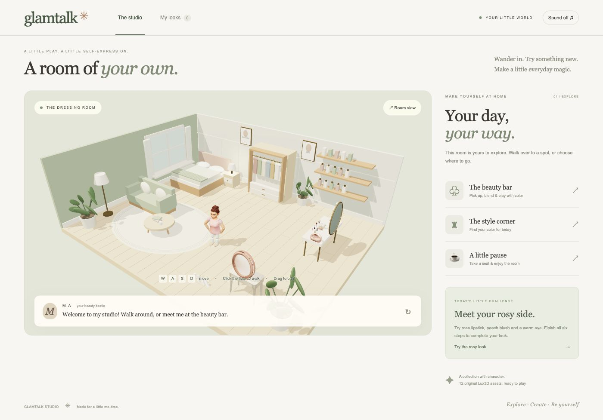

# GlamTalk 3D

A playable browser makeup game built with Codex, Three.js and **12 Aholo Lux3D-generated assets**. Explore a furnished studio, dress the character, create a makeup look and save it to a personal lookbook.



## Gameplay preview

[Watch or download the 85-second gameplay walkthrough](gameplay-preview.mp4). It shows room exploration, outfit changes, the lounge, all six makeup steps and the finished look, with dialogue.

## Run the game

No build step or package installation is required. Download the repository and serve its folder with a static web server. For example, with Python 3 installed:

```sh
python3 -m http.server 8000
```

Open **http://localhost:8000**, wait for the models to load, and click **Start Game**. The source version must be served over HTTP because browsers restrict loading model files directly from local folders.

## How to play

- Move with **WASD / arrow keys**, or click the floor to walk there.
- Drag the scene to orbit; scroll to zoom.
- Use the sidebar destinations to walk to the beauty bar, wardrobe or sofa.
- Press **E** near a destination to interact.
- At the beauty bar, select a product and shade, then **Pick up & apply**.
- Start a choice-led makeover story: pick Everyday glow, Rosy afternoon, or Glam night out, then complete the guided six-step look—or choose free exploration.
- Change outfit colors at the wardrobe.
- Choose **Save my look**, then download the image from **My looks**.
- Enable **Sound** for browser-synthesized character dialogue.
- Touch devices have on-screen movement buttons.

## Aholo Lux3D contribution

Lux3D generated the main character, lipstick, mascara tube, mascara wand, eyeshadow palette, blush compact, foundation bottle, powder brush, eyeshadow brush, eyeliner, vanity table/mirror and makeup bag. These are the actual models used by the game.

Generation prompts and settings are in [generation-prompts.json](generation-prompts.json). Textures were resized for practical browser loading; geometry was preserved. See [ASSET-OPTIMIZATION.json](ASSET-OPTIMIZATION.json).

Room structure, supplementary furniture, legs, arm/hand articulation, character navigation, makeup surface masks and interactions were implemented locally. The generated upper-body character was adapted with a simplified runtime rig. Held products are parented to a palm grip during application and returned to their table positions afterward.

## Project structure

- `index.html` — responsive website and game UI
- `style.css` — layout and visual design
- `game.js` — room, navigation, character rig, makeup interactions and lookbook
- `*_glb.glb` — 12 optimized Lux3D models
- `three.module.js`, `GLTFLoader.js`, `BufferGeometryUtils.js` — bundled Three.js runtime
- `gameplay-preview.mp4`, `preview.png` — demonstration media
- `generation-prompts.json`, `ASSET-OPTIMIZATION.json`, `TESTED.md` — production and verification records

## Technical details

Static HTML/CSS/JavaScript, Three.js WebGL rendering, GLTFLoader, procedural collision-aware navigation, custom character skinning/IK, shader-based makeup and browser speech synthesis. No API keys, paid-generation calls or backend are required to play.

## Current limitations

The character rig and hand motion are stylized, not cinematic-quality motion capture. The mirror is decorative rather than a live reflection. Browser speech availability varies. Lookbook images are session-only unless downloaded. The original asset mesh and texture quality varies across products.

## Attribution

Three.js is distributed under the MIT license; its notice is included in [LICENSE-three.txt](LICENSE-three.txt). Lux3D asset provenance is documented above. No new blanket license is asserted for generated assets or project code in this submission.
